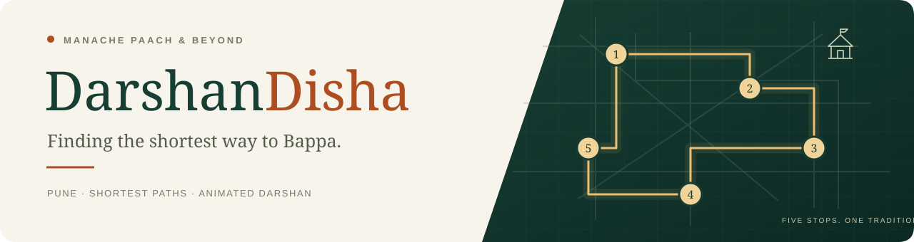
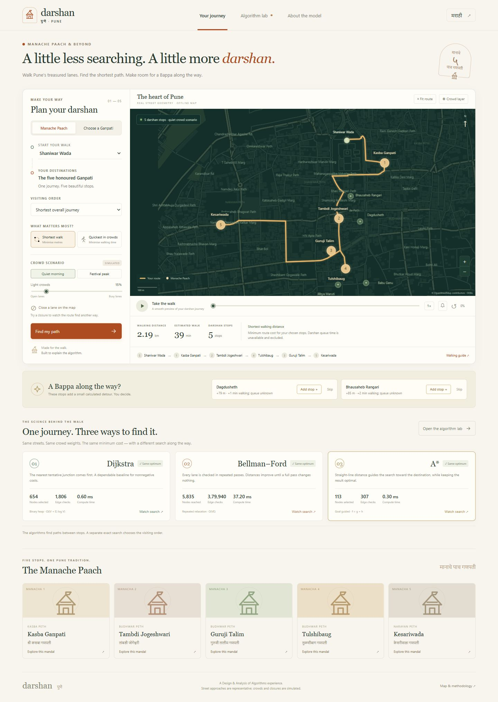
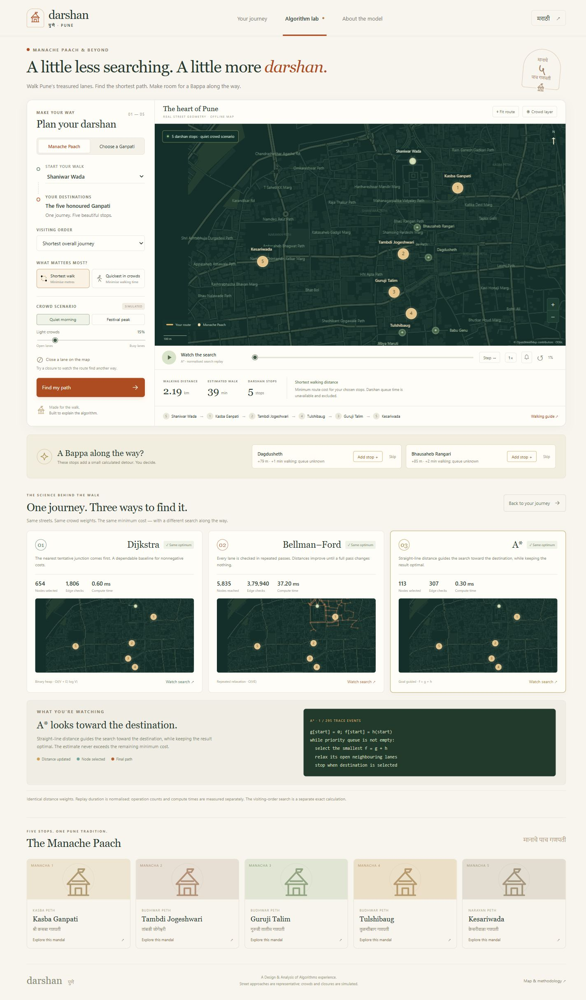

<p align="center">
  
</p>

<p align="center">
  <strong>Pune's Ganpati tradition meets the science of shortest paths.</strong><br />
  An interactive, offline simulation for Design &amp; Analysis of Algorithms.
</p>

<p align="center">
  
  
  
  
  
  
</p>

<p align="center">
  <a href="#the-experience">Explore</a> &nbsp;·&nbsp;
  <a href="#run-locally">Run locally</a> &nbsp;·&nbsp;
  <a href="#inside-the-algorithms">Algorithms</a> &nbsp;·&nbsp;
  <a href="DEMO_GUIDE.md">Presentation guide</a>
</p>

---

## A little less searching. A little more darshan.

**DarshanDisha** lets you plan a walk through Pune's **Manache Paach Ganpati**, choose a destination such as **Dagdusheth**, and discover another Ganpati along the way. Follow your route on a bundled street map, increase the simulated crowds, close a lane, and watch the path change.

Then open **Algorithm Lab** to see how **Dijkstra, Bellman–Ford, and A\*** solve the same journey. Their searches look different, but they agree on the minimum cost for the same graph and objective.



## The experience

| Feature | What you can do |
| --- | --- |
| **Manache Paach journey** | Visit all five main mandals in an optimised order or preserve their traditional order. |
| **Choose a Ganpati** | Plan a single-destination walk to Dagdusheth or another included mandal. |
| **A Bappa along the way?** | See optional stops with calculated extra distance and walking time. Add or skip each suggestion. |
| **Two route objectives** | Minimise metres with **Shortest walk**, or estimated walking time with **Quickest in crowds**. |
| **Crowd scenarios** | Switch between Quiet morning and Festival peak, or adjust the crowd slider. |
| **Lane closures** | Close and reopen lanes on the map to explore rerouting and unreachable destinations. |
| **Animated walks** | Play, pause, scrub, reset, and change playback speed; optionally enable arrival bells. |
| **Interactive map** | Pan, zoom, fit the route, show the crowd layer, or pick a custom starting junction. |
| **Algorithm Lab** | Compare search traces, edge checks, updates, pseudocode, and measured computation time. |
| **3D Algorithm Lab** | Replay each recorded step on a tabletop model of Pune or a small teaching graph, with cost pillars, live pseudocode and the relaxation arithmetic. |
| **Walking guide** | Read the street sequence, save a text itinerary, or print the route. |
| **Accessible layout** | Use mobile layouts, Marathi mandal labels, and reduced-motion support. |
| **Offline demonstration** | Run the bundled map and application without API keys or internet access. |

### Five stops. One Pune tradition.

| Honour | Main mandal | Area |
| :---: | --- | --- |
| 1 | **Kasba Ganpati** | Kasba Peth |
| 2 | **Tambdi Jogeshwari** | Budhwar Peth |
| 3 | **Guruji Talim** | Budhwar Peth |
| 4 | **Tulshibaug** | Budhwar Peth |
| 5 | **Kesariwada** | Narayan Peth |

Other included stops: **Dagdusheth Halwai, Babu Genu, Bhausaheb Rangari, Akhil Mandai, and Jilbya Maruti**. Start at Shaniwar Wada, the Mandai area, an included mandal, or a junction you select on the map.

## Run locally

You need **Node.js 20 or newer** and Git to clone the repository.

```bash
git clone https://github.com/SOHAM0007-CODER/DarshanDisha.git
cd DarshanDisha
npm start
```

Open **[localhost:5173](http://localhost:5173)** in your browser and keep the terminal running. No `npm install`, build step, API key, or external map service is required.

**On Windows:** after downloading or cloning the project, you can also double-click **`START_DARSHAN.bat`**. Node.js must be installed and available on your PATH.

## Deploy on Vercel

To publish on Vercel, see **[DEPLOYMENT.md](DEPLOYMENT.md)**. The repository includes a static build and `vercel.json`; the local Node.js server is used only for local previews.

## Try a two-minute demo

1. Keep **Manache Paach** selected and click **Find my path**. Start the animated walk.
2. Switch to **Choose a Ganpati**, select **Dagdusheth**, and accept or skip a suggested stop.
3. Select **Festival peak** and **Quickest in crowds**. Compare the estimated time and distance with the alternative route.
4. Close a lane on the map and calculate the journey again.
5. Open **Algorithm Lab**, replay the searches, and explain why the minimum costs agree while operation counts differ.
6. Switch to **3D Algorithm Lab**, choose the **Teaching example**, and step through Dijkstra, Bellman–Ford and A\* one edge check at a time.

For a fuller presentation and viva preparation, see the **[demo guide](DEMO_GUIDE.md)**.

## Inside the algorithms



### Same graph. Same objective. Three searches.

| Algorithm | Search strategy | Worst-case time per leg | Role in the demonstration |
| --- | --- | --- | --- |
| **Dijkstra** | Expand the lowest known cost using a binary heap. | `O((V + E) log V)` | A dependable baseline for nonnegative weights. |
| **Bellman–Ford** | Repeatedly relax edges, stopping early when a pass makes no updates. | `O(VE)` | Makes repeated relaxation and its operation cost visible. |
| **A\*** | Prioritise `f(n) = g(n) + h(n)` using a binary heap. | `O((V + E) log V)` for this consistent-heuristic implementation | Directs the search toward the destination while preserving optimality. |

`V` is the number of junctions and `E` is the number of lane segments. Every open lane is traversable in both directions in this model, and all weights are nonnegative. The Bellman–Ford implementation is scoped to this model; it does not provide a general negative-cycle demonstration.

**Distance mode:** an edge costs its street-polyline length in metres.

**Time mode:** an edge costs its base walking time multiplied by a simulated crowd slowdown:

```text
walking speed       = 1.25 metres / second
base edge time      = edge length / walking speed
crowd multiplier    = 1 + crowd fraction × (0.2 + 4 × hotspot pressure + corridor penalty)
estimated edge time = base edge time × crowd multiplier
```

Hotspot pressure decreases with distance from selected mandals; named corridor penalties create scenario bottlenecks. These are teaching assumptions. A longer route can therefore have a lower estimated walking time.

**A\* heuristic:** straight-line distance to the goal, or that distance divided by `1.25 m/s` in time mode. Stored edge lengths round upward, and crowd multipliers are at least one, preserving the geometric lower bound.

### Choosing the visiting order

Shortest-path algorithms solve the **legs between stops**. A separate exact permutation search chooses the visiting order, comparing all **`5! = 120`** orders when all five main mandals must be visited from an external start. Pairwise route results are cached. Traditional-order mode preserves the main mandals' relative order; optional stops are inserted at a low additional cost.

Optional suggestions use graph-based detours:

```text
extra cost = cost(current → optional) + cost(optional → next) − cost(current → next)
```

Suggestions must add at most **400 metres** and **8 minutes of estimated walking**. Up to two optional stops can be accepted. Queue time is unknown and is excluded.

### Keeping the animation smooth

Calculations run in a **Web Worker** on a fixed graph snapshot. The canvas renderer caches the basemap and paints search traces incrementally; walking animation interpolates along the route geometry. Replay duration is normalised for visual comparison. Actual edge checks, updates, and compute times are reported separately from animation speed.

For multi-leg journeys, operation counts are summed across legs. Bellman–Ford's **nodes reached** and Dijkstra/A\*'s **nodes selected** describe different operations; use **edge checks** as the shared comparison metric. Runtime and frame rate depend on the device.

## The 3D Algorithm Lab

In **Algorithm Lab**, switch from **2D comparison** to **3D Algorithm Lab**. The 2D view stays available.

- **Same data, real events.** The model uses the journey's graph, weights, closures and the very runs the planner computed. Each replay step is an event recorded by `engine.mjs`; nothing is animated that the algorithm did not do. Each journey leg is its own search, so costs and predecessors reset when you change leg.
- **Cost pillars.** Pillar height is the current tentative cost `g`, on a fixed scale for the whole replay (units shown). Undiscovered nodes (`g = ∞`) have no pillar. Heights are algorithm costs, not terrain.
- **Shapes, not just colours.** Spheres are undiscovered, square pillars tentative (or reached, for Bellman–Ford), round pillars settled. A ring marks the current node, an arrow the lane being checked, a raised ribbon the final path, and a red lane with ✕ a closure.
- **Explanation panel.** The current event, the matching pseudocode line, `candidate = g(u) + w(u,v)` against the old `g(v)`, whether an update happened, and an inspector with `g`, predecessor and, for A\*, `h` and `f = g + h`. Dijkstra and A\* show live tentative priorities separately from the binary heap, which can hold outdated (stale) entries.
- **Teaching example.** An 11-node graph (`teaching-graph.mjs`) with straight-line-consistent weights, run through the same engine with **full traces**: every edge check, update, stale heap entry and pass boundary is a step. Scenarios include a closed lane and an unreachable destination; choosing the same From and To shows the zero-cost case.
- **Compact traces on Pune.** Full traces of Bellman–Ford on the Pune graph would hold about 94,000 events per leg, so the planner records selections, updates and pass boundaries, and counts unsuccessful checks in the following step. The lab states this grouping.
- **Replay controls.** Play, pause, previous, next, reset, speed, and a scrubber. Moving backward restores a sparse checkpoint and replays forward, so every position is rebuilt exactly. Replay speed is in recorded steps per second. Playback length does not measure runtime; measured operation counts and compute time are shown separately.
- **Camera.** Drag to orbit, right-drag to pan, scroll to zoom, plus Reset and Top-down buttons and keyboard controls. The scene renders only when something changes, frees GPU memory when you leave, and recovers from WebGL context loss. Without WebGL, a flat 2D view replays the same state. Reduced-motion preferences turn off camera easing.

## Project structure

```text
DarshanDisha/
├── index.html           # Application layout
├── styles.css           # Responsive visual design
├── app.mjs              # Journey controls, playback, and interactions
├── map.mjs              # Offline canvas map and trace rendering
├── engine.mjs           # Algorithms, crowd weights, and itinerary planning
├── worker.mjs           # Background route computation (journeys and teaching runs)
├── lab3d.mjs            # 3D Algorithm Lab controls, replay and explanations
├── trace-player.mjs     # Deterministic replay state from recorded engine events
├── scene3d.mjs          # Three.js tabletop renderer (loaded on demand)
├── lab-flat.mjs         # 2D fallback renderer when WebGL is unavailable
├── lab-colors.mjs       # Shared 3D lab palette
├── teaching-graph.mjs   # 11-node teaching example run through the same engine
├── vendor/three/        # Three.js 0.186.1 + OrbitControls, served locally (MIT)
├── server.mjs           # Local Node.js server
├── START_DARSHAN.bat    # Windows launcher
├── data/
│   ├── map.json         # Bundled street geometry and routing graph
│   └── osm-source.xml   # Original OpenStreetMap extract
├── scripts/             # Map preparation, static build, Three.js vendoring
├── tests/               # Routing correctness tests
├── previews/            # Screenshots and README banner
├── DEMO_GUIDE.md        # Presentation walkthrough
├── PROJECT_PLAN.md      # Design blueprint
└── VALIDATION.md        # Verification record
```

The application uses **HTML, CSS, vanilla JavaScript ES modules, Canvas 2D, Web Workers, Web Audio, and Node.js built-ins**. The 3D Algorithm Lab adds **WebGL via Three.js**, vendored in `vendor/three/` (refresh with `node scripts/vendor_three.mjs`) and loaded only when the lab opens. Python is only needed for the optional data-preparation scripts.

## Verify the model

```bash
npm test
```

The nine routing tests cover an independent **Floyd–Warshall oracle**, agreement across all three algorithms on Pune routes, closed and disconnected paths, heuristic consistency, all 120 five-stop orders, optional-stop detours, crowd-based rerouting, identical start/destination, and accepted extras with traditional ordering.

Ten replay tests (`tests/trace-player.test.mjs`) check that trace detail never changes results or operation counts, that compact traces account for every edge check, that stepping backward and scrubbing rebuild exactly the state of a fresh forward replay, that heap sizes and explanations match the engine, and that the teaching graph agrees with a Floyd–Warshall oracle for every source, target and scenario.

Browser verification and animation observations are documented in **[VALIDATION.md](VALIDATION.md)**.

## Map data and scope

The packaged central-Pune graph contains **1,167 junctions** and **1,570 undirected pedestrian lane segments**, simplified while retaining street geometry. Explicit `access=no/private` and `foot=no` restrictions are filtered out. Ordinary motor-vehicle one-way rules are not treated as pedestrian restrictions.

The map uses a bundled **[OpenStreetMap](https://www.openstreetmap.org)** extract. Map data and the derived `data/map.json` are **© OpenStreetMap contributors**, licensed under **[ODbL 1.0](https://www.openstreetmap.org/copyright)**. The source extract is included for reproducibility. Mandal reference: **[Manache Paach guide](https://puneganpati.in/guides/manache-paach)**. The interface and temple illustrations are original.

**This is an educational simulation.** Crowd levels and lane closures are simulated; the application has no live crowd or queue feed. Pins represent nearby street approaches rather than verified festival gates. Dagdusheth uses its mapped temple approach rather than a seasonal pavilion. Estimated times cover walking only, and current festival access must be checked on site.

---

<p align="center">
  Created by <a href="https://github.com/SOHAM0007-CODER">Soham</a> for Design &amp; Analysis of Algorithms.<br />
  <em>Finding the shortest way to Bappa.</em>
</p>
